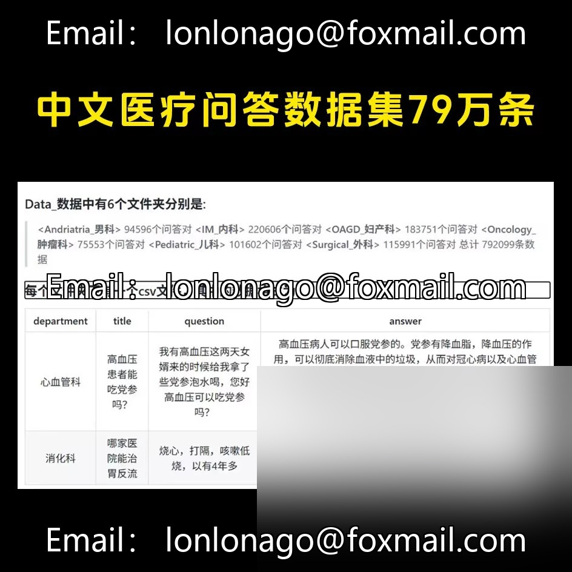
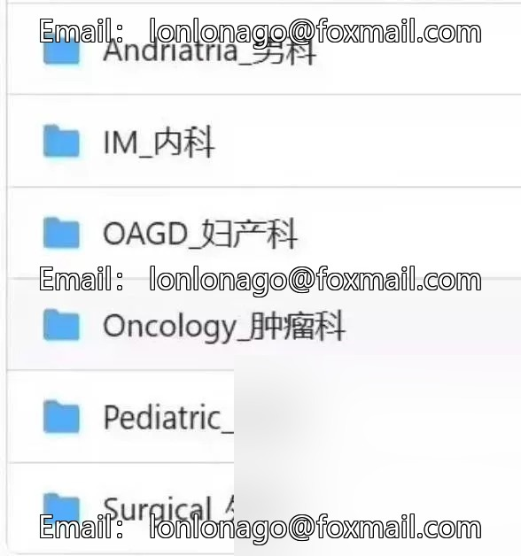

# Chinese medical Q&A dataset of 790,000 entries

## Body

Chinese medical Q&A dataset of 790,000 entries
Does not involve personal information!
Fields include: department, title, question, answer

Data: There are 6 folders in the data, which are:
Man: 94596 question-answer pairs
Internal Medicine: 220606 question-answer pairs
Obstetrics and Gynecology: 183751 question-answer pairs
Oncology: 75553 question-answer pairs
Pediatrics: 101602 question-answer pairs
Surgery: 115991 question-answer pairs
Total: 790,000 data records

web-based shipment, can be directly photographed and shipped.

The dataset consists of 790,000 Chinese medical Q&A entries across six folders (and a csV file per folder) with fields department, title, question and answer, and explicitly excludes private information.

<!-- AI_ENRICHED -->

## Images

## Payment

Here is a pay link on Stripe ( https://buy.stripe.com/3cs8yP7sY87d0vu9AB ). Please contact me lonlonago@foxmail.com after funding $89, and I will send you a complete data files , thank you!

